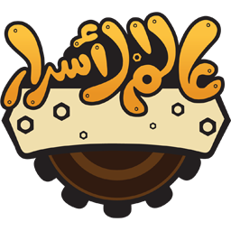

<div align="center">

<a href="#support-the-project"></a>
<a href="#solana"></a>
<a href="#evm-networks"></a>
<a href="#bitcoin"></a>
<br>
<a href="#evm-networks"></a>
<a href="#evm-networks"></a>
<a href="#evm-networks"></a>
<br>
<a href="#evm-networks"></a>
<a href="#evm-networks"></a>
<a href="#evm-networks"></a>

<br><br>



# Asda Story Revival

<a href="https://discord.gg/anQRWEKVqG"></a>

</div>

Asda Story Revival is a community project to rebuild the original Asda Story MMORPG with a Godot client and a compatible game server, both written in C#. The original game guides the reconstruction of its maps, interface, and gameplay. Arabic is the client’s initial language, with support for additional translations.

The goal is to release the project as open source so anyone can download it, run a playable version, and adapt it to their own ideas. Shared tools and documentation will help contributors restore classic content, edit maps and interfaces, add new systems, and share their improvements.

The project is in active development. The first stable, playable release will be published here with the source code and setup instructions.

## Progress

✅ Done &nbsp;&nbsp; ⬜ Not done yet

### Server (C#)

The server speaks the original game's network protocol and stores its data in PostgreSQL. A new unified server replaces the original's separate server programs, one part at a time. Each part must give the same results as the original server for the same requests.

✅ The original server programs reproduced in C#, used as the reference server\
✅ The original database and its stored procedures moved to PostgreSQL\
✅ Login, server and channel lists, character list and selection\
✅ Entering the world, loading character data and saving on logout\
✅ Movement and seeing other players\
✅ Items: moving, equipping, potions, drops and pickup\
✅ Monsters: spawns, idle and walking behavior, patrols and walking NPCs\
✅ Combat with monsters: normal attacks, monsters fighting back, death, revive and respawn\
✅ Experience and level-up\
✅ Skills: learning, casting, cooldowns, buffs and other states\
✅ Soul guard and its skills\
✅ Player versus player combat and duels\
✅ Area chat, emotions and fame\
⬜ Party, whisper, friends and guilds\
⬜ Trading between players\
⬜ Portals between maps\
⬜ The unified server running the whole game on its own

### Client (Godot, C#)

✅ Original startup screen and game icon\
✅ Login screen rebuilt from the original artwork, layout and texts\
✅ Server, channel and character selection\
✅ Arabic interface by default, with selectable translations\
✅ The starting map, Alpen, with its original terrain and scenery\
✅ Click-to-move, running, jumping and camera control\
✅ Original HUD: HP, MP and EXP bars, target panel, buffs and cooldowns\
✅ Inventory, equipment, item tooltips and cosmetic avatar slots\
✅ Worn armor and weapons shown on characters, with upgrade glows and auras\
✅ Character window\
✅ Skill window, skill bar and casting with the original animations, effects and sounds\
✅ Monsters with their original models and animations\
✅ Combat with damage numbers, death and respawn\
✅ Item drops on the ground and pickup\
✅ Other players, duels, area chat and emotions\
✅ Soul guard\
✅ Usable items and the premium package\
⬜ Party, guild, trade and friends windows\
⬜ Travel to the other maps\
⬜ First playable public release

## Community

Join the project's Discord server, in Arabic with an English chat channel, to follow development, share ideas and old memories of the game, and help with testing or translation: https://discord.gg/anQRWEKVqG

## Support the project

If you would like to support development, donations are welcome. Please check the network before you send. USDT can be sent on Solana to the Solana address, or on Ethereum, BNB Chain or Polygon to the EVM address.

### Solana

SOL and USDT on Solana

```text
2d6zxzE9D27yX3hXJeriyBVGw3w3Q1FhEEhQhzhZ73FJ
```

### EVM networks

ETH and USDT on Ethereum, BNB Chain, Base, Polygon, Robinhood, ARC and HyperEVM

```text
0xBBc28fA66AA2AA189b7cD6DD1Ca89e79A5596d9C
```

### Bitcoin

Bitcoin (Taproot)

```text
bc1pmulqwc05rugm5q0x03m3nwv6sa7a9um3gcjh3nksyyrxpvp5rpzscywt0x
```

<div align="center">

<a href="#support-the-project"></a>
<a href="#solana"></a>
<a href="#evm-networks"></a>
<a href="#bitcoin"></a>
<br>
<a href="#evm-networks"></a>
<a href="#evm-networks"></a>
<a href="#evm-networks"></a>
<br>
<a href="#evm-networks"></a>
<a href="#evm-networks"></a>
<a href="#evm-networks"></a>

</div>
